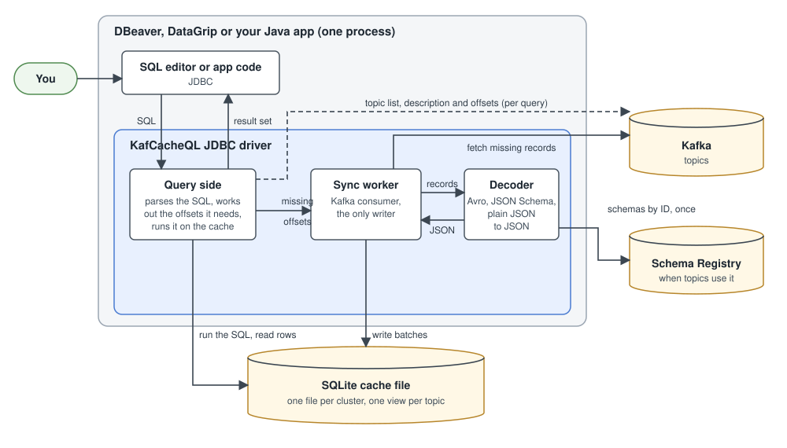

# KafCacheQL

*Kafka + Cache + Query Language*

> **Work in progress.** This driver is in early development (see [Status](#status)). Queries run through
> JDBC, from a tool's SQL editor or JVM code, and tools list topics and columns in their navigators.
> Nothing here is stable: names, settings and behaviour may change. Not for production use.

**What if you could query Kafka topics from your database tool of choice? No consumer code, just a JDBC
driver. And best of all, whatever you query is cached locally, automatically.**

KafCacheQL is a read-only JDBC driver for Apache Kafka. Point DBeaver, DataGrip or any JVM application at a
Kafka cluster and query topics with plain SQL:

```sql
SELECT status, count(*)
FROM "orders"
WHERE _timestamp >= unixepoch('now', '-15 minutes') * 1000
GROUP BY status;
```

The idea: each topic is a table. Records are fetched from Kafka once and kept in a local SQLite file, so the
next query only fetches what's new. Joins, aggregations and JSON functions are SQLite's.

## What it's for

- Looking at what's in a topic from the SQL tool you already use, without a Kafka UI or a consumer script.
- Ad hoc questions and joins across topics: reference data, configuration, the latest state of compacted
  topics.
- Checking topic contents in tests and while developing.
- Working with a topic's data offline, from the cache (`offline=true`).

## What it isn't

- **Not real-time.** There are no continuous queries and no streaming results. A query answers from the cache
  as it stands once the query's data has been fetched; to see newer records, run the query again.
- **Not for production systems.** It's a tool for people exploring data, not a component to build services on.
- **Not a Kafka consumer replacement.** It has no consumer group and no processing guarantees. Applications
  that process events should use the Kafka clients or Kafka Streams.
- **Read-only.** SELECT only: no INSERT, UPDATE or DELETE, and it never produces to Kafka.
- **Not a database server.** Nothing runs besides your tool and Kafka (plus Schema Registry, when topics use it).

## Quick start with Docker

This runs everything on your machine: the Confluent Platform stack in this repository (a Kafka broker and
Schema Registry), two sample topics, and DBeaver.

Requirements: Docker, Java 21 or newer and Maven 3.9 or newer to build the driver, and
[DBeaver](https://dbeaver.io/). The driver works with Kafka 3.1 or newer (Confluent Platform 7.1 or newer).

### 1. Start Kafka and Schema Registry

```sh
docker compose up -d broker schema-registry
```

The broker listens on `localhost:9092` and Schema Registry on `http://localhost:8081`.
`docker compose up -d` also starts Control Center on <http://localhost:9021>.

### 2. Build the driver

```sh
mvn package -DskipTests
```

This builds `target/kafcacheql-jdbc-0.1.0-SNAPSHOT.jar`, one self-contained JAR (about 40 MB) with Kafka's
and Confluent's libraries relocated inside it, so it doesn't clash with other versions in the same
application. It carries native libraries for Linux, macOS and Windows on x86-64 and ARM64 only. Measured
timings for large topics are in [docs/performance.md](docs/performance.md). Copy it somewhere stable: `mvn clean` deletes `target/`.

### 3. Create two sample topics

A compacted `customers` topic and an append `orders` topic, with Avro values in Schema Registry: run the
commands in [docs/sample-topics.md](docs/sample-topics.md#customers-and-orders-avro-schema-registry). That
page also has a plain JSON and a JSON Schema topic.

### 4. Write a settings file

Create `~/.kafcacheql/local.properties` (`mkdir -p ~/.kafcacheql` first):

```properties
schema.registry.url=http://localhost:8081
```

See [Configuration](#configuration) for everything else it can hold.

### 5. Add the driver to DBeaver

1. **Database → Driver Manager → New**, with *Driver Type* **Generic** (not a copy of another database's
   driver, or DBeaver runs that database's own queries on connect).
2. *Libraries*: add the JAR, then pick the class `io.github.ifnesi.kafcacheql.driver.KafCacheQLDriver`
   (*Find Class* lists it).
3. *Settings*: URL template `jdbc:kafcacheql://{host}:{port}?config.file={file}`, default port `9092`,
   "No authentication". With `{file}` in the template, the connection page shows a *Path* field for the
   settings file. If your DBeaver version doesn't show it, use `jdbc:kafcacheql://{host}:{port}` and add a
   user property `config.file` under the connection's *Driver properties* instead.

After rebuilding the JAR, copy it again and restart DBeaver, which keeps the old one loaded.

### 6. Connect and query

1. Create a connection with the driver: host `localhost`, port `9092`, and the path of the settings file
   (`~/.kafcacheql/local.properties`). *Test Connection*.
2. Open the connection: the navigator lists the topics you can access, `customers` and `orders` among
   them. Topics you haven't queried yet show only the built-in columns; their schema fields appear after
   the first query, once you refresh the navigator.
3. Open an SQL editor and try:

```sql
-- Orders per status in the last 15 minutes: Kafka is read from the first record of that time onwards
SELECT status, count(*) FROM "orders"
WHERE _timestamp >= unixepoch('now', '-15 minutes') * 1000
GROUP BY status;

-- Join the orders with the latest state of each customer
SELECT o.order_id, o.amount, c.name, c.country
FROM "orders" AS o JOIN "customers" AS c ON c.key = o.customer_id
WHERE o._timestamp >= unixepoch('now', '-1 day') * 1000;
```

The cache file is `~/.kafcacheql/<cluster-id>.db`. Run the same query again and only new records are
fetched.

### A demo: a web store on Zeppelin

[docs/demo.md](docs/demo.md) runs a producer writing ten related web-store topics (customers, products,
stock, orders, payments, shipments, deliveries and more) and an Apache Zeppelin note that charts them through
KafCacheQL: `docker compose -f demo/compose.yaml up -d --build`, then <http://localhost:8090>.

## How it works



1. A query names topics as tables: `"orders"`, `"payments.v1"`.
2. For each topic, the driver works out which offsets the query needs. Compacted topics are read up to their
   end; append topics are read for the window the query's `WHERE` clause asks for on `_partition`, `_offset`
   or `_timestamp`, or a default window (the last hour, at most 10,000 records per partition) when it doesn't
   say.
3. Only the offsets not yet cached are fetched, then decoded (Avro and JSON Schema with Schema Registry, plain
   JSON, strings and bytes; Protobuf later) and stored as JSON in SQLite, with each record's
   `_partition`, `_offset`, `_timestamp`, `_key` and `_headers`.
4. SQLite runs the query. Each topic's table is a view with a column per field of the schemas its cached
   records were written with.

Compacted topics hold the latest value per key in each partition, as Kafka does, and tombstones delete keys.
When the cache could have missed deletions, or a topic was recreated, the topic is rebuilt.

What each JDBC call (connect, the navigator, a query) does in Kafka and Schema Registry, and the Kafka
permissions it needs: [docs/jdbc.md](docs/jdbc.md).

## What a query reads

The `WHERE` clause on `_partition`, `_offset` and `_timestamp` decides which records each topic is read
for; only those not yet cached are fetched.

| Query | Reads |
|---|---|
| An append topic, no `_offset` or `_timestamp` bound | The default window: the last hour, at most 10,000 records per partition, with a warning saying so |
| `_timestamp >= …` | From the first record at that time, to the end |
| `_partition = 0 AND _offset BETWEEN 0 AND 10` | Exactly that range |
| `_offset >= 0` | Everything Kafka still holds |
| `ORDER BY _offset DESC LIMIT n`, no other `WHERE` than `_partition` | The `n` highest offsets of each partition, nothing else |
| A compacted topic, any `WHERE` | Its full state: the latest value of every key, always read to the end |
| Any query with `offline=true` | The cache only; a range that isn't cached fails, naming it |

Conditions inside `OR`, functions applied to these columns and subqueries don't narrow what's read. Details
in [docs/sql.md](docs/sql.md#what-a-query-reads).

## SQL examples

The examples on `orders` and `customers` run on the [quick start](#quick-start-with-docker)'s data; the last
two show syntax on topics you'd have yourself.

Queries are SQLite's SQL, SELECT only. Each topic is a view named after it, with the record's `_partition`,
`_offset`, `_timestamp` (epoch milliseconds), `_key`, `_value` (decoded, as JSON) and `_headers`, plus a
column per top-level field of its schemas (for plain JSON, of the keys in its newest 1,000 cached records).
Nested values stay JSON. An Avro decimal's column is SQLite `NUMERIC`, exact to about 15 significant digits;
`_value` keeps the exact text. Columns, names and the few SQL forms the driver refuses:
[docs/sql.md](docs/sql.md).

```sql
-- Orders per status in the last 15 minutes: Kafka is read from the first record of that time onwards
SELECT status, count(*)
FROM "orders"
WHERE _timestamp >= unixepoch('now', '-15 minutes') * 1000
GROUP BY status;

-- An exact offset range in one partition
SELECT _offset, order_id, amount
FROM "orders"
WHERE _partition = 0 AND _offset BETWEEN 0 AND 10;

-- No _offset or _timestamp bound: the default window applies (the last hour, at most 10,000 records per
-- partition) and the driver adds a warning saying so
SELECT * FROM "orders" ORDER BY _timestamp DESC LIMIT 100;

-- Join an append topic with a compacted reference topic (always read to its end)
SELECT o.order_id, o.amount, c.name, c.country
FROM "orders" AS o
JOIN "customers" AS c ON c.key = o.customer_id
WHERE o._timestamp >= unixepoch('now', '-1 day') * 1000;

-- Any field through JSON, even one without a column yet
SELECT _value ->> '$.status' AS status, _key FROM "orders" WHERE _offset >= 0;

-- The 5 highest offsets: a tail query fetches only the last 5 records of each partition, with no default
-- window. Offsets are per partition, so for the newest records sort by _timestamp instead
SELECT order_id, status, _partition, _offset FROM "orders" ORDER BY _offset DESC LIMIT 5;

-- Syntax only: nested fields, and records carrying a given header
SELECT o._value ->> '$.address.city' AS city
FROM "shipments" AS o, json_each(o._headers) AS h
WHERE o._timestamp >= unixepoch('now', '-1 hour') * 1000
  AND h.value ->> '$.key' = 'trace-id';

-- Syntax only: topic names with dots or dashes are quoted
SELECT count(*) FROM "payments.v1" WHERE _offset >= 0;
```

### Plain JSON and JSON Schema topics

With the `events` (plain JSON) and `payments` (JSON Schema) topics from
[docs/sample-topics.md](docs/sample-topics.md):

```sql
SELECT type, count(*) AS n, avg(ms) AS avg_ms FROM "events" WHERE _offset >= 0 GROUP BY type;

SELECT p.payment_id, p.method, p.amount, o.status
FROM "payments" AS p JOIN "orders" AS o ON o.order_id = p.order_id
WHERE p._offset >= 0 AND o._offset >= 0;
```

### Offline, and fewer Kafka checks

With `offline=true` the driver never contacts Kafka or Schema Registry and answers from the cache file
alone, so `cache.path` must name it. Add a second connection with its own settings file, for example
`~/.kafcacheql/offline.properties`:

```properties
offline=true
cache.path=~/.kafcacheql/local.db
```

and set `cache.path=~/.kafcacheql/local.db` in `local.properties` too, so both use the same file. Offline,
the same queries answer from what's cached: the default window counts back from each partition's newest
cached record, results carry a warning with the cache's as-of time, and a range that isn't cached fails,
naming it. The navigator lists only cached topics.

Online, `max.staleness.ms=60000` in a settings file skips the Kafka checks (topic description and offsets)
for a topic checked in the last minute, so repeated queries answer straight from the cache; timestamp
bounds still ask Kafka for their offsets.

### Compacted topics and Kafka calls

Compacted topics hold one row per key in each partition, as Kafka does. If partitions were added to a topic,
a key can appear in more than one; pick the newest with `_timestamp`.

Each query checks the topic ID, partition count and offsets with Kafka; a connection reads each topic's
configuration once. During long syncs, progress is logged every five seconds per partition.

## Status

| Stage | State |
|---|---|
| Build, shaded JAR, test environment | Done |
| Driver, URL and configuration | Done |
| Client settings, credentials kept out of logs and errors | Done |
| Kafka clients: cluster ID, topic metadata, offsets | Done |
| SQLite cache file and its internal tables | Done |
| Topic tables, decoding, syncing records into the cache | Done |
| Cache validity and rebuilds, SQL analysis, windows, query rewrite | Done |
| Typed views from cached schema IDs | Done |
| Whole-query pipeline, incremental fetches and progress | Done |
| Connections, statements, result sets, column types from the schema | Done |
| Database metadata in tools (navigator, autocomplete) | Done |
| Checked by hand in DBeaver and DataGrip | Next |
| Offline mode and `max.staleness.ms` | Done |
| Columns for plain JSON topics, inferred from cached records | Done |
| JSON Schema with Schema Registry | Done |
| Protobuf | Later |
| Refresh drops topics Kafka no longer lists | Done |
| Cache size and age limits (`cache.max.bytes`, `cache.retention.hours`) | Done |
| Web-store demo on Zeppelin | Done |

## Configuration

```
jdbc:kafcacheql://localhost:9092?config.file=~/.kafcacheql/local.properties
```

That's the quick start's Docker stack. For a cluster, list one or more of its brokers, comma-separated:
`jdbc:kafcacheql://broker1:9092,broker2:9092?config.file=/path/to/client.properties`. Keep every setting in
the `config.file`: any Kafka or Schema Registry client setting works there, so the `client.properties` file
Confluent Cloud generates for Java clients does too. Keep credentials out of the URL, which tools show and
log.

Every driver setting, the order settings are read in, per-topic overrides and authentication:
[docs/configuration.md](docs/configuration.md).

## Other databases

The cache is SQLite, and that's the only engine planned. Other engines, DuckDB first, for large analytical
scans of append topics, may be assessed later. They're not planned yet: a different engine would change the
SQL dialect your queries are written in.

## The cache

**What stays cached.** Each query that touches an append topic also deletes the cached records Kafka has
already deleted, by time or size retention, so the cache keeps no more than the topic does. Compacted topics
always follow the topic's latest values. A tool's Refresh (which lists topics) drops the cached copy of any
topic Kafka no longer lists. Otherwise a topic you stop querying keeps its cached data, unless you set limits:

- `cache.max.bytes`: over it, the oldest cached append records go first, across topics, then whole
  compacted topics, least recently queried first.
- `cache.retention.hours`: cached append records older than that are deleted, whatever Kafka keeps.

Anything evicted is fetched again by the next query that needs it.

**Security.** The cache is a plain, unencrypted copy of topic data on your local disk, outside Kafka's
access controls; the file is readable by you only. Revoking someone's Kafka access doesn't revoke their local
copy, until a Refresh no longer lists the topic or the file is deleted. `topics.include` and
`topics.exclude` only decide what tools list: they aren't access control, and excluded topics stay
queryable. The settings file holds credentials in plain text: keep it readable by you only. Treat the cache
like any local copy of that data, and check your organisation's rules before caching production topics.

**Sharing a cache.** Several connections, tools or applications can use one cache file at once, as long as
they run on the same machine (not on a network share, nor shared between your host and a Docker Desktop
container) and agree on the settings that shape the cache ([docs/configuration.md](docs/configuration.md#the-drivers-own-settings)).
Queries run side by side; one sync writes at a time, in batches of `sync.batch.records`, each its own
transaction. A query reads a consistent snapshot, but another program reading the SQLite file directly can
see a sync between its batch commits.

## Development

The integration tests need the Docker Compose stack in this repository: a Confluent Platform broker (KRaft)
on `localhost:9092` (and SASL/PLAIN on `localhost:9094`, user `test`, password `test-secret`), Schema
Registry on `http://localhost:8081`, and Control Center with Prometheus and Alertmanager on
<http://localhost:9021>. The tests create topics with unique names and leave them behind; after many runs the broker can run out of
memory, and `docker compose down && docker compose up -d` starts it again with no topics.

```sh
docker compose up -d broker schema-registry   # enough for the tests; `docker compose up -d` adds Control Center on http://localhost:9021
mvn verify                                    # unit and integration tests
mvn verify -DskipITs                          # unit tests only, no Docker needed
```

A cache file made by an older build is refused while the cache's layout keeps changing; delete it (by
default `~/.kafcacheql/<cluster-id>.db`) and it's rebuilt on the next query.

Some tests log warnings on purpose, and they all print. Tests that recreate topics, expire tombstones or
change settings log `Rebuilding topic …`, and Kafka's consumer logs `inconsistent topic ID` /
`unknown topic or partition` for a recreated topic. Tests of unreachable brokers or Schema Registry log
connection errors to `localhost:1` or to a closed port, and the wrong-password test logs Kafka's
`failed authentication`. Tests of misspelt settings log `isn't a KafCacheQL
property`. A test fails only on its own assertions.

## License

[Apache License 2.0](LICENSE)
