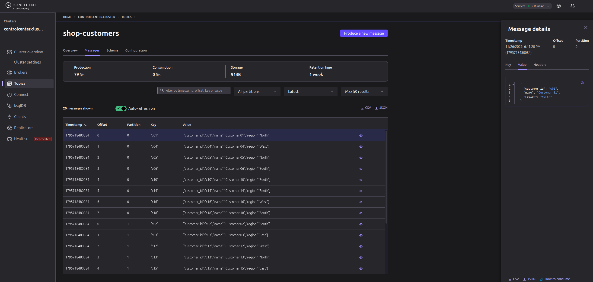
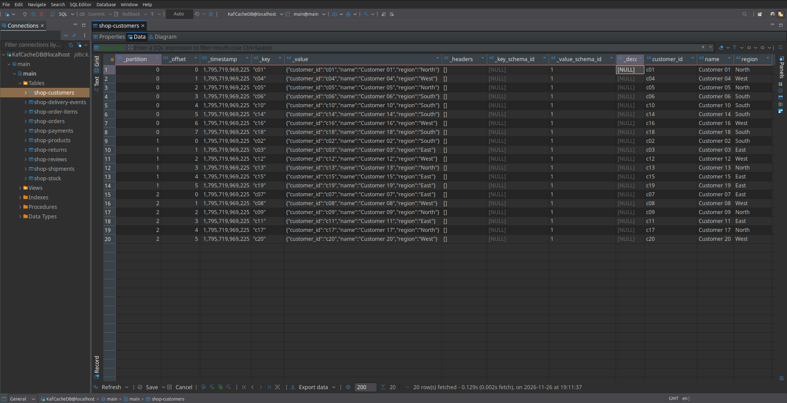
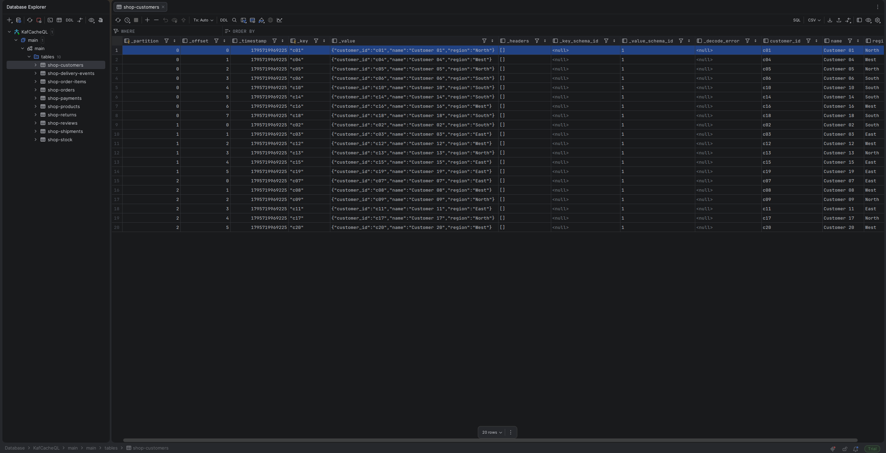

# KafCacheQL

[][latest-release]
[](pom.xml)
[](https://kafka.apache.org/)
[](LICENSE)
[][driver-jar]

**Explore Kafka with SQL, in the database tool you already use.**

Add one JDBC JAR to DBeaver, DataGrip or a Java application. Topics become tables you can filter, join and
aggregate without writing a consumer. KafCacheQL keeps a local copy of fetched records in a SQLite file: its
cache. Repeated queries fetch only missing records. Offline queries use that copy without contacting Kafka.

Built for **ad-hoc SQL exploration, debugging, and offline querying of Kafka topics**. Each query sees a
consistent snapshot of the cached data; rerun it to fetch new records. This is not real-time streaming.

For experimentation, not recommended for production use.

**Why not Flink SQL or ksqlDB?** Use them to build pipelines: continuous queries that run on a cluster and
write results back to Kafka. Confluent Cloud's Flink can also answer one-off snapshot queries, through its own
JDBC driver, on a Flink compute pool billed in CFUs. KafCacheQL needs none of that:

- **Kafka 3.1+:** Confluent Cloud, Confluent Platform 7.1+, self-managed or on a laptop. See
  [supported authentication](docs/configuration.md#authentication).
- **Nothing to deploy or pay for:** one JAR inside your SQL tool, and a properties file.
- **A local cache:** a rerun fetches only new records, and cached topics stay queryable offline.
- **Made for debugging:** a record that fails to decode stays a row, with the error and its raw bytes, next to
  its partition, offset and headers.

The same `shop-customers` topic in three tools. In Confluent Control Center:



In DBeaver, with schema fields exposed as columns:



And in DataGrip:



These topics come from the [web-store demo](demo/README.md).

## How it works

The driver runs inside your tool. Kafka holds the source data; SQLite stores the local copy and runs your SQL.


A topic appears as a table, but its rows depend on the kind of topic:

- **Append topics** are event histories: each record is a row, including records with the same key.
- **Compacted topics** are current state: one row per key per partition, updated by newer records. A tombstone
  (a record with a null value) removes that key's row.

When you run a query:

1. The driver works out which records it needs. For an append topic, that range is the query's **window**. The
   default is the whole topic. Offset or timestamp conditions, or an optional configured window, can narrow
   it. Compacted topics are read to their end before SQL filters their state.
2. It fetches missing records and decodes them. The record's key and value remain available as JSON in `_key`
   and `_value`, after any configured transforms. Avro, JSON Schema and Protobuf schemas also supply columns
   for their fields; plain JSON columns are inferred from cached records.
3. SQLite runs your SELECT, including joins and aggregations, on the cached snapshot.

The first query can take time on a large topic. Later queries reuse the cache. You can also open an **offline
connection** to query data already cached, without Kafka or Schema Registry. A range that is missing from the
cache fails instead of returning an incomplete answer.

No separate query service is needed. Schema Registry is used for records that name a schema. KafCacheQL never
produces records or commits consumer offsets to Kafka. Besides SELECT, it accepts only a few [cache
statements](docs/sql.md#cache-statements) that list, describe, sync or drop topics in the local cache. The cache is an
unencrypted local copy; see [cache security](docs/configuration.md#cache-security). Optional
[record transforms](docs/transforms.md) drop or mask private fields before they reach that copy.

## Quick start

This sets up a small customer-and-order dataset and answers an order summary in your SQL editor.

You need Git, Docker Compose and [DBeaver](https://dbeaver.io/) or
[DataGrip](https://www.jetbrains.com/datagrip/), running on Java 21 or newer. KafCacheQL supports Kafka 3.1+;
the bundled stack uses Confluent Platform 8.4.0.

### 1. Start the stack

The stack provides Kafka, Schema Registry and Control Center for inspecting the original records. Get the
repository and start the stack from its top folder, `kafcacheql`:

```sh
git clone https://github.com/ifnesi/kafcacheql.git
cd kafcacheql
docker compose up -d
```

Wait for Kafka on `localhost:9092` and Schema Registry on <http://localhost:8081>. Control Center is at
<http://localhost:9021>.

### 2. Download the driver

The driver is one self-contained JAR, with native libraries for Linux, macOS and Windows on x86-64 and ARM64.
Download version 0.1.0, `kafcacheql-jdbc-0.1.0.jar`, from the [v0.1.0
release](https://github.com/ifnesi/kafcacheql/releases/tag/v0.1.0), and save it where your tool can load it:

```sh
mkdir -p ~/.kafcacheql
curl -fL -o ~/.kafcacheql/kafcacheql-jdbc.jar \
  https://github.com/ifnesi/kafcacheql/releases/download/v0.1.0/kafcacheql-jdbc-0.1.0.jar
```

Saving it without the version keeps your tool's settings the same when you upgrade. These docs describe the
next release. v0.1.0 lacks [record transforms](docs/transforms.md), the [command line](docs/cli.md) and the
[cache statements](docs/sql.md#cache-statements), and shows header values as base64; until the next release,
[build the driver](#development) to get them.

### 3. Add sample data and settings

Create the [customers and orders sample topics](docs/sample-topics.md#customers-and-orders): customer state
and order history, linked by customer ID. Create `~/.kafcacheql/local.properties` so the driver can find their
Avro schemas:

```properties
schema.registry.url=http://localhost:8081
```

### 4. Connect and query

In DBeaver, create a **Generic** JDBC driver, add the copied JAR and select `KafCacheQLDriver` with **Find
Class**. Connect to `localhost:9092` with the settings file above. [Step-by-step DBeaver and DataGrip
setup](docs/tools.md).

Open an SQL editor to group the orders by status and total their amounts:

```sql
SELECT status, count(*) AS orders, sum(amount) AS total
FROM "orders"
GROUP BY status;
```

The sample data returns two paid orders, one new order and one shipped order. Refresh the tool's navigator
after this query to see the schema fields as columns. See [what a query reads](docs/sql.md#what-a-query-reads)
before trying a larger topic.

## Go further

- [SQL reference and examples](docs/sql.md): joins, JSON, offset ranges and tail queries.
- [Command line](docs/cli.md): run SQL from a terminal or a script, and keep a cache warm with `SYNC`.
- [Configuration](docs/configuration.md): authentication, windows, parallel fetching, cache limits and offline
  use.
- [DBeaver and DataGrip](docs/tools.md): driver setup and replacing the JAR safely.
- [Record transforms](docs/transforms.md): drop or mask private fields before caching, with settings or Java.
- [JDBC behavior and permissions](docs/jdbc.md): which actions contact Kafka or Schema Registry.
- [Sample topics](docs/sample-topics.md): Avro, plain JSON and JSON Schema data to try.
- [Web-store demo](demo/README.md): related topics, privacy examples and charts in Apache Zeppelin.
- [Performance measurements](docs/performance.md): cold queries, cache reuse and parallel fetching.

## Development

Building needs Java 21+ and Maven 3.9+. From the repository's top folder, `kafcacheql`, build the JAR and copy
it where your tool loads it; tools keep the loaded file open, so a rebuild in `target/` would break them:

```sh
mvn package -DskipTests
cp target/kafcacheql-jdbc.jar ~/.kafcacheql/kafcacheql-jdbc.jar
```

Run the automated checks against the local stack, or run only the unit tests without Docker:

```sh
mvn verify                 # unit and integration tests
mvn verify -DskipITs        # unit tests only; no Docker needed
```

Integration tests create uniquely named topics and may leave them behind. The stack's Kafka data lives in its
containers: `docker compose down` discards it.

## License

[Apache License 2.0](LICENSE)

[latest-release]: https://github.com/ifnesi/kafcacheql/releases/latest
[driver-jar]: https://github.com/ifnesi/kafcacheql/releases/download/v0.1.0/kafcacheql-jdbc-0.1.0.jar
