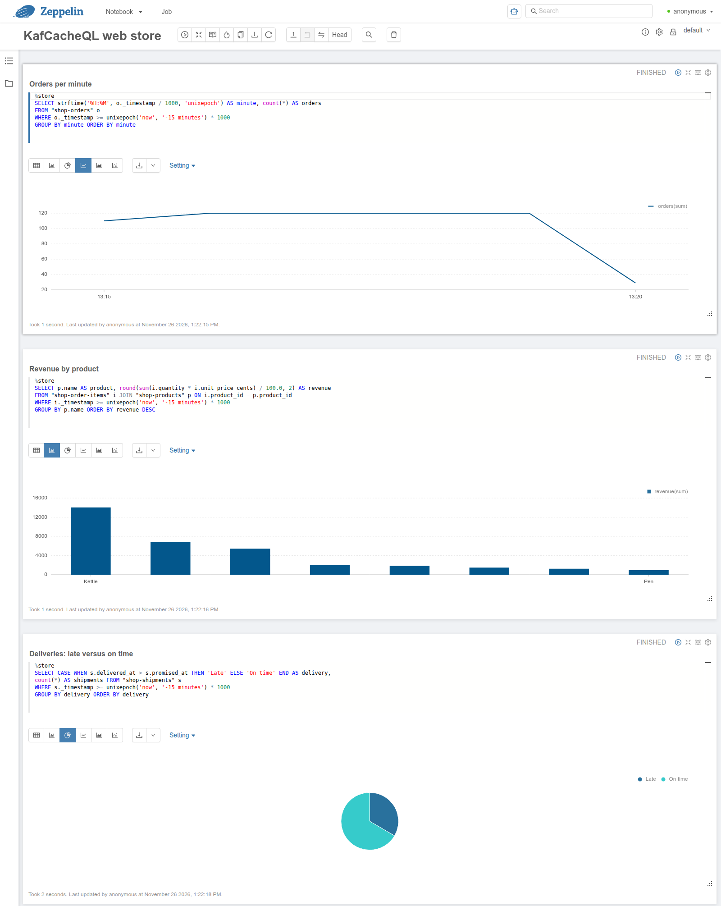
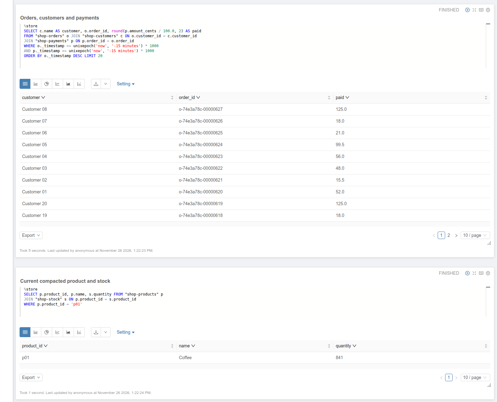
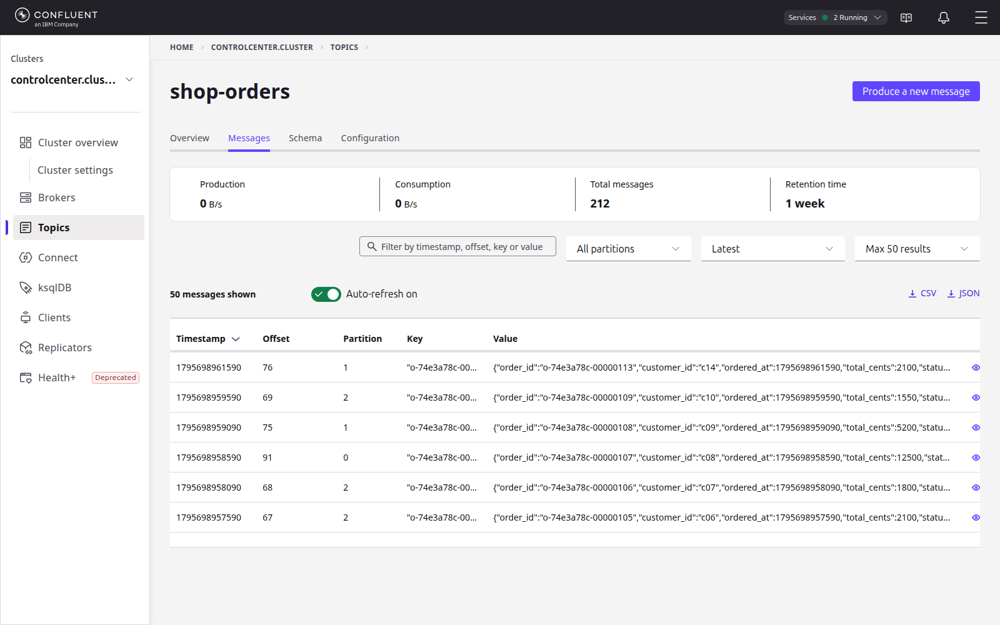

# Web-store demo

A small online shop, simulated in Kafka, and queried with plain SQL.

Customers order products. Each order is paid for, shipped and delivered, and some deliveries arrive late. Now
and then a customer returns an item or writes a review. A Python producer writes these events into twelve
Kafka topics, about two orders per second.

[Apache Zeppelin](https://zeppelin.apache.org/), a web notebook, queries those topics through KafCacheQL and
charts the results. No consumer code and no stream processing: each chart is one SQL query. KafCacheQL keeps
fetched records in a local SQLite cache, so later queries can reuse them. The demo shows:

- **Joins across topics:** orders with their customers, payments, items and products.
- **Aggregations and charts:** orders per minute, revenue by product, late versus on-time deliveries.
- **Two kinds of topic:** compacted topics read as the current state (a product's stock now); append topics
  read as a history of events (every order).
- **Record transforms:** drop private fields, hash join keys and headers, and derive an age band before
  caching.
- **New records on demand:** rerun a query and it fetches only the records produced since the last run.

## The topics

Each topic has three partitions. Keys are plain strings: record IDs, or email addresses in the two privacy
topics. The `_key` column holds the decoded key as JSON. Values are Avro, so each top-level value field is a
column. IDs join across topics: an order's `customer_id` is a customer's key, and its `order_id` appears in
its items, payment and shipment.

The table describes the data in Kafka, before the [privacy transforms](#privacy-topics) change what is cached:

| Topic | Cleanup | Key | Value fields |
|---|---|---|---|
| `shop-customer-profiles` | compact | email | `customer_id`, `email`, `phone`, `birth_date`, nested `address` |
| `shop-customer-notes` | delete | email | `note_id`, `email`, `birth_date`, `age_band`, `text` |
| `shop-customers` | compact | customer ID | `customer_id`, `name`, `region` |
| `shop-products` | compact | product ID | `product_id`, `name`, `category`, `price_cents` |
| `shop-stock` | compact | product ID | `product_id`, `quantity`, `updated_at` |
| `shop-orders` | delete | order ID | `order_id`, `customer_id`, `ordered_at`, `total_cents`, `status` |
| `shop-order-items` | delete | item ID | `item_id`, `order_id`, `product_id`, `quantity`, `unit_price_cents` |
| `shop-payments` | delete | payment ID | `payment_id`, `order_id`, `amount_cents`, `method`, `paid_at` |
| `shop-shipments` | delete | shipment ID | `shipment_id`, `order_id`, `region`, `promised_at`, `delivered_at` |
| `shop-delivery-events` | delete | shipment ID | `event_id`, `shipment_id`, `order_id`, `status`, `event_at` |
| `shop-returns` | delete | return ID | `return_id`, `order_id`, `product_id`, `quantity`, `reason` |
| `shop-reviews` | delete | review ID | `review_id`, `order_id`, `customer_id`, `product_id`, `rating` |

Times are epoch milliseconds; amounts are cents. A delivery is late when `delivered_at` is after
`promised_at`.

The demo reads a 15-minute **window** of append history: the range of recent events used by a query. Compacted
topics provide their current state.

## Privacy topics

The two customer privacy topics contain fake personal data in Kafka. They show how to remove or mask fields
before KafCacheQL writes its local copy. **Masking** replaces a value with a repeatable hash, so matching
values can still join without exposing the original.

- `shop-customer-profiles` uses settings alone: it hashes the email key, `email` and `address.postcode`, and
  drops `phone`, `birth_date` and `address.street`. Dropped schema columns read as NULL.
- `shop-customer-notes` also uses [ShopPrivacy.java](transforms/demo/ShopPrivacy.java). The class derives
  `age_band` from the birth date and removes emails from `text`. Then settings drop the key and birth date,
  and hash `email`.

Both use the same secret, so their masked email columns still join. Both remove `authorization` headers and
mask `client-ip` header values. The notebook's last two queries show the masked join and the changed notes.
Kafka still holds the original fake data; transforms only change the cache. See
[record transforms](../docs/transforms.md) to apply your own policy, with or without Java.

## Running it

Start the stack with step 1 of the [quick start](../README.md#quick-start). The demo loads the driver from
`target/`, so build it with `mvn package -DskipTests` (Java 21+ and Maven 3.9+). Then start the demo from the
repository root:

```sh
docker compose -f demo/compose.yaml up -d --build
```

Compose compiles the demo class in a Java 21 JDK container, starts the producer and Zeppelin, and installs
the connection and notebook. No separate host compiler step is needed for the class.

Open <http://localhost:8090> and select the **KafCacheQL web store** note. Run its seven paragraphs: three
charts (orders per minute, revenue by product, late versus on-time deliveries), a three-topic join, and the
current stock of a product, a masked customer join and transformed customer notes. Rerun a paragraph to see
newer records.

To check that all seven paragraphs run, without opening a browser:

```sh
docker compose -f demo/compose.yaml run --rm check
```

## What you'll see

The note after about five minutes of producing, its charts first:



Then its tables: orders joined to customers and payments, and a compacted lookup of current stock:



The same `shop-orders` records, as Kafka holds them, in Control Center at <http://localhost:9021>:



## A five-topic join

Revenue and late deliveries by customer region and product category, across orders, customers, order items,
products and shipments:

```sql
SELECT c.region,
       p.category,
       count(DISTINCT o.order_id) AS orders,
       round(sum(i.quantity * i.unit_price_cents) / 100.0, 2) AS revenue,
       count(DISTINCT CASE WHEN s.delivered_at > s.promised_at THEN o.order_id END) AS late_orders
FROM "shop-orders" o
JOIN "shop-customers" c ON c.customer_id = o.customer_id
JOIN "shop-order-items" i ON i.order_id = o.order_id
JOIN "shop-products" p ON p.product_id = i.product_id
LEFT JOIN "shop-shipments" s ON s.order_id = o.order_id
GROUP BY c.region, p.category
ORDER BY revenue DESC;
```

After about a minute of producing, on an empty cache, it returned in about three seconds:

| region | category | orders | revenue | late_orders |
|---|---|---:|---:|---:|
| West | Kitchen | 30 | 1530.0 | 10 |
| North | Kitchen | 16 | 1440.0 | 6 |
| West | Home | 30 | 1185.0 | 10 |
| … | | | | |

Run it in a new Zeppelin paragraph starting with `%store`, using the demo's window, or from [DBeaver or
DataGrip](../docs/tools.md), which read whole topics by default.

## Producing faster

The rate defaults to two orders per second. To produce five orders per second:

```sh
ORDERS_PER_SECOND=5 docker compose -f demo/compose.yaml up -d producer
```

## Configuration and cleanup

The demo joins the root stack's fixed `kafcacheql` network and creates no broker or registry.
[compose.yaml](compose.yaml) mounts the JAR read-only from `target/` and keeps the cache and notes in named
volumes. The [image](zeppelin/Dockerfile) supplies Java 21 for Zeppelin's JDBC interpreter. Connection
settings are in [interpreter.json](zeppelin/interpreter.json) and
[kafcacheql.properties](kafcacheql.properties), which sets the window and transforms. Its `mask.secret` is for
this demo only. The compiled class's JAR is mounted beside the driver and loaded by the JDBC interpreter.

Stop the demo before rebuilding the JAR, then start it again to load the new classes:

```sh
docker compose -f demo/compose.yaml down
```

Add `--volumes` to discard the demo's cache and notes, for example if a new driver refuses the old cache
format. Its `shop-*` Kafka topics and Schema Registry subjects remain; the root stack keeps running.
