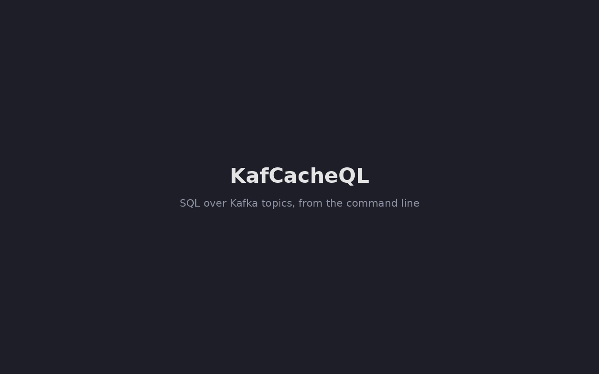

# Command line

The driver's JAR is also a command-line tool. It runs SQL against Kafka from a terminal or a script, using the
same cache and settings as your SQL editor. It needs only Java 21 or newer.

The command line and the [cache statements](sql.md#cache-statements) come with the next release; v0.1.0
doesn't have them. Until then, [build the driver](../README.md#development) from the repository.



```sh
alias kafcacheql='java -jar ~/.kafcacheql/kafcacheql-jdbc.jar'
URL='jdbc:kafcacheql://localhost:9092?config.file=~/.kafcacheql/local.properties'
```

The tool takes the same [JDBC URL](configuration.md#the-url) as your SQL editor. Keep passwords and API keys
in the settings file, never in the URL or on the command line, where shell history and other users can see
them.

If your settings use a [Java transform](transforms.md#writing-a-java-transform), its JAR must be on the class
path. `java -jar` ignores any other class path, so name both JARs and the tool's class instead:

```sh
alias kafcacheql='java --enable-native-access=ALL-UNNAMED -cp ~/.kafcacheql/kafcacheql-jdbc.jar:/path/to/my-transforms.jar io.github.ifnesi.kafcacheql.cli.Main'
```

`--enable-native-access=ALL-UNNAMED` lets the prompt's terminal library load without a Java warning; `java
-jar` already allows it.

On Windows, separate the JARs with `;` instead of `:`.

## Run statements

The examples use the [customers and orders sample topics](sample-topics.md#customers-and-orders). Each
argument after the URL is one statement. The tool runs them in order, prints each result and exits:

```sh
kafcacheql "$URL" 'SYNC "orders"' 'SELECT status, count(*) AS orders FROM "orders" GROUP BY status'
```

```text
table_name | fetched_records
-----------+----------------
orders     | 4
status  | orders
--------+-------
NEW     | 1
PAID    | 2
SHIPPED | 1
```

Every statement the driver accepts works here, including the [cache statements](sql.md#cache-statements):
`SHOW TABLES`, `DESCRIBE`, `DROP TABLE` and `SYNC`.

### Semicolons and quotes

| Where | Ends a statement |
|---|---|
| An argument on the command line | The end of the argument; no `;` needed |
| A script on standard input, or the interactive session | A `;` at the end of a line |
| `help`, `quit`, `exit` in the session | Nothing; they need no `;` |

As in any SQL, a table name that contains `-` or `.` needs double quotes: `DESCRIBE "shop-orders"`, not
`DESCRIBE shop-orders`, which fails with a syntax error that says so. `SYNC` is the exception: it takes topic
names and patterns with or without quotes.

To run a script, pass it on standard input. A statement ends with a `;` at the end of a line, so a `;` inside
a line, such as in a quoted value, doesn't end it:

```sh
kafcacheql "$URL" < queries.sql
```

## Interactive session

Start the tool from a terminal without a statement for a prompt. It first shows where it's connected and which
cache file it uses, the same file your SQL editor uses with the same settings. Type statements ending with
`;`, as many as you like, and `quit` or `exit` to leave (Ctrl-D works too):

```text
$ kafcacheql "$URL"
KafCacheQL 0.2.0, connected to localhost:9092
Cache: ~/.kafcacheql/MkU3OEVBNTcwNTJENDM2Qk.db
Type help for commands, quit to leave.
kafcacheql> SHOW TABLES;
...
kafcacheql> SELECT order_id, customer_id, amount FROM "orders"
       ...> WHERE status = 'PAID';
...
kafcacheql> quit
```

The cache file is named after the cluster's ID unless `cache.path` sets it. With `offline=true`, the first
line reads `KafCacheQL 0.2.0, offline (cache only)`. The banner never shows the
URL or your settings, which can hold passwords.

Type `help` for the statements and keys:

```text
kafcacheql> help
Statements end with ';' at the end of a line. Quote names that contain '-' or '.'.

  SELECT ... ;               Query topics as tables; fetches what the query needs first
  SHOW TABLES;               Topics, with cached rows and bytes
  DESCRIBE "<table>";        A table's columns and types
  SYNC [<pattern>, ...];     Fetch everything new: cached topics, or names with * and ?
  DROP TABLE "<table>";      Remove a topic from the local cache; Kafka is unchanged

  help                       This list (no ';' needed)
  mode [table|line|json]     Show or change how results print
  quit, exit                 Leave (or Ctrl-D)
  Ctrl-C                     Cancel the running statement
  Up and down arrows         Earlier statements
  Ctrl-R                     Search earlier statements
  Ctrl-A, Ctrl-E             Start, end of the line

Docs: https://github.com/ifnesi/kafcacheql/blob/main/docs/cli.md
```

- One connection stays open for the whole session, so queries after the first reuse it and start faster.
- An error is printed and the prompt returns.
- Ctrl-C cancels the running statement, not the session.
- The line editor uses the same keys as bash. Besides those in the list: Ctrl-K and Ctrl-U delete to the end
  or start of the line, Alt-B and Alt-F move by word, and Ctrl-L clears the screen.
- History is kept in memory only, never written to a file, since queries can contain customer data.
- `mode` shows how results print, and `mode line` (or `table`, `json`) changes it for the rest of the
  session. The session starts in the mode given with `--mode`.
- `help`, `mode`, `quit` and `exit` are session commands, not SQL: a script or argument sends them to the driver,
  which refuses them.

## Output

Results print as a table by default. Put `--mode` before the URL to choose another layout:

| Mode | Prints |
|---|---|
| `table` | Aligned columns under a header row (the default) |
| `line` | One `name: value` line per column, with a blank line between rows. Easier to read when rows are wide |
| `json` | A JSON array of objects, one per row |

NULL prints as `NULL` in `table` and `line`.

```sh
kafcacheql --mode line "$URL" 'SELECT _offset, _key, _value FROM "customers" LIMIT 2'
```

```text
_offset: 0
   _key: "c1"
 _value: {"name":"Ada","country":"UK"}

_offset: 1
   _key: "c2"
 _value: {"name":"Linus","country":"FI"}
```

```sh
kafcacheql --mode json "$URL" 'SELECT _offset, _key, _value FROM "customers" LIMIT 1'
```

```json
[{"_offset":0,"_key":"c1","_value":{"name":"Ada","country":"UK"}}]
```

Numbers stay numbers, and `_key`, `_value` and `_headers` are nested JSON, so the output can go straight to
tools such as `jq`.

Results go to standard output. Errors and warnings, such as an expired range or a `DROP TABLE` notice, go to
standard error with `ERROR:` or `WARN:` in front. The tool prints no log output. Some errors you may see:

```text
kafcacheql> SELEC * FROM "orders";
ERROR: Unknown statement "SELEC": only SELECT, WITH ... SELECT, SHOW TABLES, DESCRIBE, DROP TABLE and SYNC are supported. Type help for the list.
kafcacheql> DESCRIBE shop-orders;
ERROR: SQL syntax error at line 1, column 14: unexpected token '-'. Quote names that contain '-' or '.', such as "my-topic".
kafcacheql> SYNC nope*;
ERROR: SYNC pattern matches no topic: nope*.
```

The exit status is 0 when every statement succeeded and 1 otherwise. Arguments and scripts stop at the first
failing statement; an interactive session carries on.

## Keep a cache warm

Run `SYNC` on a schedule so the cache is up to date before you query it, or before you go offline. A cron
entry that syncs the cached topics every 10 minutes:

```text
*/10 * * * * java -jar ~/.kafcacheql/kafcacheql-jdbc.jar 'jdbc:kafcacheql://localhost:9092?config.file=~/.kafcacheql/local.properties' 'SYNC'
```

What to sync:

| Statement | Syncs |
|---|---|
| `SYNC` | Every topic already in the cache (the ones you've queried before) that the navigator still lists |
| `SYNC orders, shop-*, *-events, orders-20??` | The named topics and patterns, cached or not |
| `SYNC *` | Every topic your editor's navigator lists, cached or not. Uncached topics are fetched in full, which can be a lot of data |

In a pattern, `*` matches any run of characters and `?` exactly one, anywhere in the name:

| Pattern | Matches, for example |
|---|---|
| `shop-*` | `shop-orders`, `shop-customers` |
| `*-events` | `delivery-events`, `shop-delivery-events` |
| `shop-*-events` | `shop-delivery-events` |
| `orders-20??` | `orders-2025`, `orders-2026`, but not `orders-202` |
| `?rders` | `orders`, `Orders` |

Matching is case-sensitive, as Kafka topic names are: `orders` doesn't match `Orders`. Patterns only match
topics the navigator lists, so a topic hidden by `topics.include` or `topics.exclude` is never synced. Topic names need no
quotes here, even with `-` or `.`. A pattern that matches no topic fails the statement before anything is
fetched, so a typo in a scheduled job shows up as an error.

A systemd timer works the same way.

- **Use the same settings file as your SQL editor.** Different cache or transform settings would rebuild each
  other's topics.
- **Runs never overlap.** If the previous run is still syncing, the next fails at once instead of fetching the
  same records again; it exits with 1 and the next scheduled run carries on.
- **Queries on cached records don't wait** for a running `SYNC`. A query that must fetch waits its turn, as
  behind any other sync.
- `SYNC` fetches everything new, with no cap. See [SYNC or SELECT](sql.md#sync-or-select).
