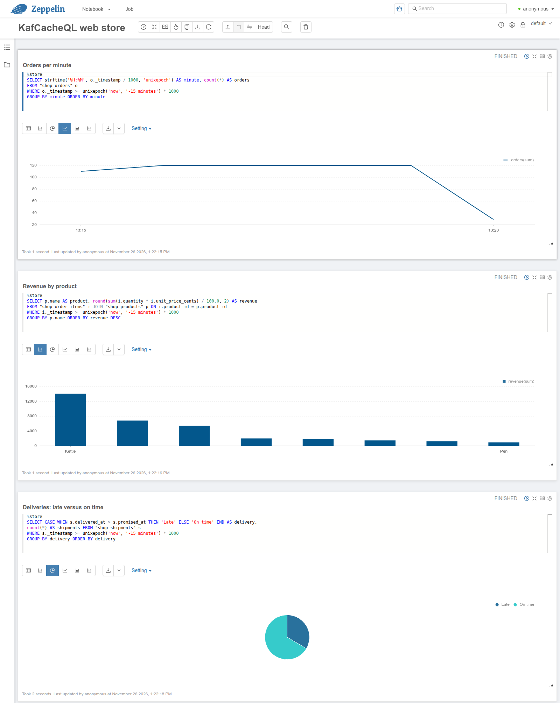
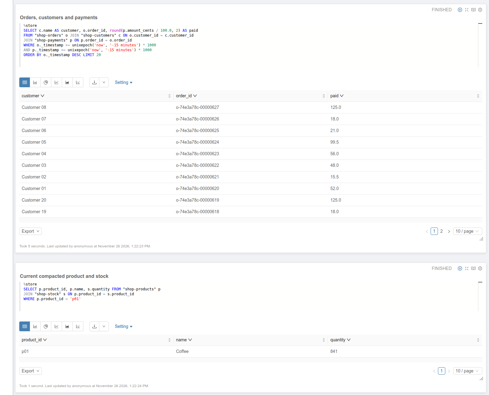
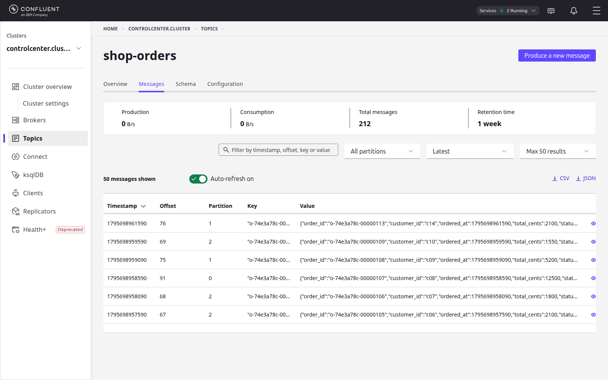

# Web-store demo

Requires the existing Kafka / Schema Registry stack, Docker Compose, and the shaded
JAR. From the repository root:

```sh
docker compose up -d broker schema-registry
mvn package -DskipTests
docker compose -f demo/compose.yaml up -d --build
```

Open <http://localhost:8090>, select **KafCacheQL web store**, and run its five
paragraphs. The first three have line, bar and pie charts; the others show a
three-topic join and the current compacted product/stock state. Rerun paragraphs
to fetch new records. After about 20 seconds, the REST check runs every paragraph:

```sh
python3 demo/check.py
```

The note after about five minutes of producing, its charts first:



and its tables: a three-topic join and a compacted lookup:



The same `shop-orders` records as Kafka holds them, in Control Center (<http://localhost:9021>, started by
the root `docker compose up -d`):



The producer writes ten Avro topics named `shop-*`: customers, products and stock
are compacted; orders, order-items, payments, shipments, delivery-events, returns
and reviews are append topics. IDs join across topics. It simulates completed
orders with an accelerated delivery lifecycle, including late deliveries. The
rate defaults to two orders per second; change it with
`ORDERS_PER_SECOND=5 docker compose -f demo/compose.yaml up -d producer`.

The demo joins the stack's `kafcacheql` network (a fixed name in the root
`docker-compose.yml`). It creates no broker or
registry, and is independent of `mvn verify`. The JAR is mounted read-only from
`target/`; the JDBC URL and network addresses are in
`demo/zeppelin/interpreter.json` and `demo/kafcacheql.properties`. Cache and notes
use named container volumes. The one-shot configure service installs the JDBC
setting and shipped note through Zeppelin's REST API.

The thin image uses Apache Zeppelin 0.12.1 unchanged for the Java 11 server and
copies the JRE from Eclipse Temurin 21.0.9_10. Only the JDBC interpreter receives
`JAVA_HOME=/opt/java21`, with the mounted JAR on `CLASSPATH`. Python 3.12.12 and
all producer packages are pinned, including confluent-kafka 2.12.2 and fastavro
1.13.1. Recreate Zeppelin after rebuilding the JAR to reload its classes.

Stop only the demo:

```sh
docker compose -f demo/compose.yaml down
```

Add `--volumes` to discard the demo's cache and notes. Its `shop-*` Kafka topics
and Schema Registry subjects remain; the test stack keeps running.

The Java split was checked against Zeppelin 0.12.1's
[`StandardInterpreterLauncher`](https://github.com/apache/zeppelin/blob/v0.12.1/zeppelin-zengine/src/main/java/org/apache/zeppelin/interpreter/launcher/StandardInterpreterLauncher.java)
and [`common.sh`](https://github.com/apache/zeppelin/blob/v0.12.1/bin/common.sh):
uppercase properties become process environment variables, and `JAVA_HOME` selects
`bin/java`. Live `/proc/<pid>/exe` checks confirmed the server's Java 11 path and
the JDBC interpreter's `/opt/java21/bin/java`; that binary reported 21.0.9+10.

## Checked run

2026-11-26: all five paragraphs returned `SUCCESS` / `TABLE` through Zeppelin's
synchronous REST API while the producer ran at two orders per second:

| Paragraph | Returned |
|---|---|
| Orders per minute | Five minute buckets, 391 orders total |
| Revenue by product | Eight products; Kettle 9,000.00, Coffee 950.00 |
| Deliveries late versus on time | Late 134; on time 266 |
| Three-topic join | Twenty customer/order/payment rows |
| Compacted lookup | `p01`, Coffee, quantity 955 |

Queries ran sequentially against live data, so their counts reflect different
captured ends. All chart configurations were also read back from the REST API.
